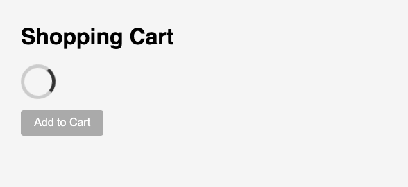

<h1>
  <span class="headline">Selenium: Debugging and Stabilizing Tests</span>
  <span class="subhead">Best Practices for Flaky Test Prevention</span>
</h1>

**Learning objective:** Apply best practices to avoid flaky behavior, such as chaining waits and validating conditions before interacting.

## Common timing pitfalls in applications

Modern, interactive applications typically update UI elements while the user waits. This dynamic behavior can sometimes make it challenging for automated tests to interact with elements at the right moment. Some scenarios that often cause automated tests to fail include:

- **Elements loading asynchronously:** Parts of the page appear after others, or after network requests finish. For example, an image might load after the rest of the page content.
- **UI animations and transitions:** Spinners, overlays, or pop-ups might temporarily hide the elements you want to interact with. Think of a "loading" spinner that appears and then disappears.
- **State-dependent actions:** Buttons or input fields might only become available after certain validations or data loads. A "Submit" button, for instance, might be disabled until all required fields are filled.
- **Race conditions in code:** This occurs when your test script tries to interact with a UI element before the application is truly ready for that interaction. Your test might "run ahead" of the application's readiness.

As a Selenium tester, these timing challenges can manifest in your tests as:

- An **element not found** error, even though you can clearly see it on the screen when you look manually.
- An **element present but not interactable** error, meaning the element is there, but you can't click it or type into it yet. It might be covered by another element, or simply not yet enabled.
- Tests that **pass reliably on your local machine but fail in continuous integration (CI)** environments. This often happens because CI environments might have slower resources, different network conditions, or higher latency, exaggerating the timing issues.

### The need for smart waiting

When your test script runs faster than the application can update, it's tempting to simply add a pause to your script. However, a fixed pause, often called a "hard sleep" or "static wait," is rarely the best solution.

Consider this: if you pause your script for a fixed duration, say **5 seconds**, what happens?

- If the element you're waiting for appears in 1 second, **your test still waits** for the remaining 4 seconds, unnecessarily slowing down your test suite.
- If the element takes 6 seconds to appear, your **5-second pause isn't long enough**, and your test will still fail because the element isn't ready.

This **"fixed pause"** approach is rigid and doesn't account for the actual state of the application. It's like setting an alarm for a specific time to check if a process is complete, regardless of whether it finishes sooner or needs more time. This leads to inefficient and flaky tests—tests that sometimes pass and sometimes fail without any code changes.

Instead, a smarter approach is to use **explicit waits**. Explicit waits are Selenium tools that tell your script to pause only until a specific condition happens – such as an element becoming visible, clickable, or disappearing. This ensures your test interacts with the application only when it's truly ready, making your tests more robust, reliable, and efficient.

## 1. Chaining waits and validating UI readiness

Robust Selenium tests often require chaining multiple waits to confirm that an element is truly ready before interacting with it.

Suppose you are testing a checkout flow in an international e-commerce app.

1. The **Checkout** button only becomes active after shipping options load and the terms checkbox is selected.
2. Clicking too soon results in a failed order—not because the app is broken, but because the script did not wait for the true “ready” state.

Take this common mistake:

```python
checkout_button = driver.find_element(By.ID, 'checkout')
checkout_button.click()
```

**This is a "fragile" test.** This can fail if the button is still loading, hidden, or disabled.

A safer, more realistic pattern:

```python
from selenium.webdriver.common.by import By
from selenium.webdriver.support.ui import WebDriverWait
from selenium.webdriver.support import expected_conditions as EC

wait = WebDriverWait(driver, 10)

checkout_button = wait.until(EC.presence_of_element_located((By.ID, 'checkout')))
checkout_button = wait.until(EC.visibility_of_element_located((By.ID, 'checkout')))
checkout_button = wait.until(EC.element_to_be_clickable((By.ID, 'checkout')))
checkout_button.click()
```

This ensures the element is:

- Present in the DOM
- Visible and not hidden
- Clickable and enabled

> 🧠 Layered waiting creates tests that reflect real user interactions—users wait until the app responds, and so should tests.

## 2. Using defensive testing patterns

Once an element is present, visible, and clickable, the next risk is assuming it’s the right one or in the right state. Defensive testing helps confirm that **what you're interacting with is actually correct**—especially useful when page structure or content changes over time.

Examples of defensive checks include:

- Verifying the element’s **text content** is what you expect.
- Confirming the element is **enabled** (not just clickable in theory).
- Checking that a message, label, or form appears after a key action.

Here’s an example:

```python
checkout_button = wait.until(EC.element_to_be_clickable((By.ID, 'checkout')))

# Extra validations before interacting
assert checkout_button.text.strip() == 'Checkout'  # Avoid unexpected label changes
assert checkout_button.is_enabled()                # Defensive check for app state

checkout_button.click()
```

> 💡 These assertions won’t prevent the test from failing—but they help it fail **for the right reason** with better clues, making debugging faster and more transparent.

## 3. Waiting for blocking elements to disappear

Sometimes elements are technically present but still unusable because they're covered by overlays like spinners, modals, or pop-up banners. Defensive waiting includes pausing for these transient blockers to vanish before continuing.

For example:

```python
wait.until(EC.invisibility_of_element_located((By.CLASS_NAME, 'loading-spinner')))
main_content = wait.until(EC.visibility_of_element_located((By.ID, 'main-section')))
```

This ensures your test won’t click or type into something that’s still visually or functionally blocked.

> ⚠ This pattern is critical for apps that use global overlays or animations that briefly obstruct the UI.

<div class="activity solo-exercise">
  <h2 class="title">Refactor a Flaky Test</h2>
  <span class="minutes">10 min</span>
</div>

You're working on a multilingual e-commerce site. A test that adds an item to the cart often fails because it assumes all elements are instantly ready.

**For this exercise, use the 📄 `example_2_add_to_cart.html` file created during setup.**

This page contains:

- A loading spinner that disappears after 2 seconds
- An "Add to Cart" button that becomes enabled
- A confirmation message that appears after clicking



<br>


<br>

**Create a new 📄 `add_to_cart_test.py` test file and use the following template:**

```python
from selenium import webdriver
from selenium.webdriver.common.by import By
from selenium.webdriver.support.ui import WebDriverWait
from selenium.webdriver.support import expected_conditions as EC

driver = webdriver.Chrome()

def test_cart_add_flaky(driver):
    driver.get("file:///Users/username/path/to/example_file.html")  # Replace with the full absolute path to your local HTML file

    driver.find_element(By.ID, 'add-button').click()
    confirmation = driver.find_element(By.ID, 'confirmation-msg')
    assert confirmation.text == 'Product added.'

# Run the test
test_cart_add_flaky()
driver.quit()
```

### 1. **Add an explicit wait object**

Use `WebDriverWait` to pause the test until certain UI conditions are true.

```python
wait = WebDriverWait(driver, 10)
```

### 2. **Wait for the spinner to disappear**

This prevents interactions while the page is still loading.

```python
wait.until(EC.invisibility_of_element_located((By.CLASS_NAME, 'loading-spinner')))
```

### 3. **Wait for the button to become clickable**

This ensures it’s both visible and enabled before clicking.

```python
add_btn = wait.until(EC.element_to_be_clickable((By.ID, 'add-button')))
```

### 4. **Add a defensive check**

Confirm the button label is what you expect before clicking it.

```python
assert add_btn.text.strip() == 'Add to Cart'
```

### 5. **Click the button**

Now that you're confident it's ready:

```python
add_btn.click()
```

### 6. **Wait for the confirmation message**

Don’t assume it appears instantly.

```python
confirmation = wait.until(EC.visibility_of_element_located((By.ID, 'confirmation-msg')))
```

### 7. **Validate the confirmation text**

This ensures the app responded correctly.

```python
assert confirmation.text.strip() == 'Product added.'
```

### Full refactored version

```python
from selenium import webdriver
from selenium.webdriver.common.by import By
from selenium.webdriver.support.ui import WebDriverWait
from selenium.webdriver.support import expected_conditions as EC

driver = webdriver.Chrome()

def test_cart_add_reliable():
wait = WebDriverWait(driver, 10)
driver.get("file:///Users/username/path/to/example_file.html")  # Replace with the full absolute path to your local HTML file

wait.until(EC.invisibility_of_element_located((By.CLASS_NAME, 'loading-spinner')))
add_btn = wait.until(EC.element_to_be_clickable((By.ID, 'add-button')))
assert add_btn.text.strip() == 'Add to Cart'
add_btn.click()

confirmation = wait.until(EC.visibility_of_element_located((By.ID, 'confirmation-msg')))
assert confirmation.text.strip() == 'Product added.'

test_cart_add_reliable()
driver.quit()
```

### Reflect

- What made the original test flaky?
- Which wait or validation in your new version made it more robust?
