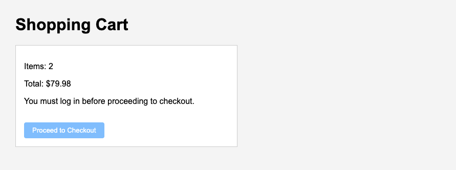
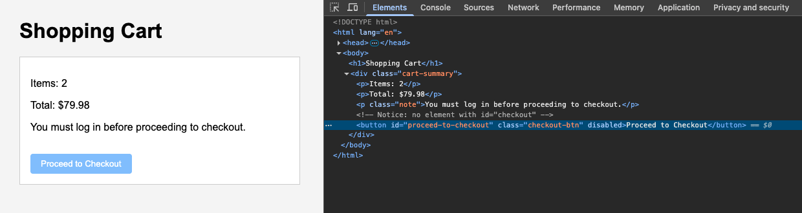
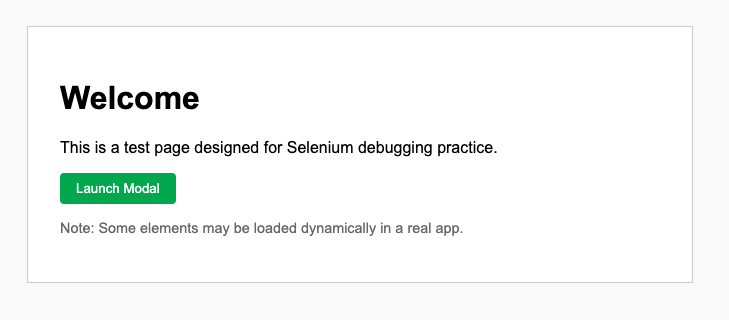
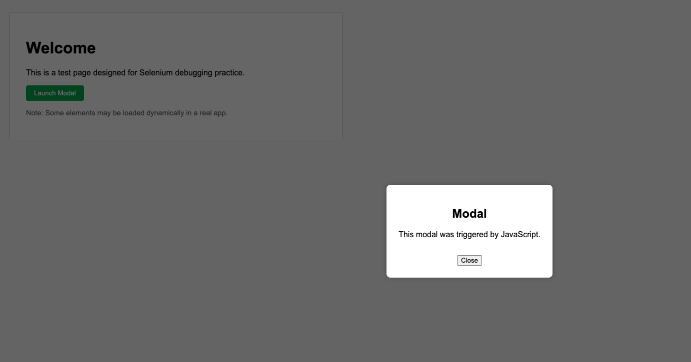

<h1>
  <span class="headline">Selenium: Debugging and Stabilizing Tests</span>
  <span class="subhead">Debugging Techniques with Browser DevTools</span>
</h1>

**Learning objective:** Use browser DevTools and `.screenshot()` or `.page_source` to debug UI state at failure time.

When building Selenium tests for dynamic web applications, you may already know how to identify exceptions and read stack traces. However, once you move beyond simple failures and face intermittent test issues—like “element not found” or timing-related errors—error messages often do not provide the detail you need. In these moments, your browser becomes more than just the environment for running tests; it becomes a powerful investigative assistant.

> Many browsers offer built-in tools known as _Developer Tools_ (or _DevTools_). These allow you to look beneath the surface of web pages, revealing what the application looks like at the precise moment your automated test interacts with it.

### Review of DevTools

Each tool offers a different perspective on what your test is experiencing.

#### 1. Elements panel:

The _Elements_ panel shows you the actual structure (HTML) of the page as rendered in the browser. It is especially valuable for answering these questions:

- Is the element you are trying to click present at all?
- Is it visible and enabled, or hidden by styling?
- Does it have a unique and stable selector?

> 💡 You can right-click on elements in the Elements panel and have DevTools generate a selector or XPath automatically, helping you avoid mistakes in your test code.

#### 2. Console panel:

You can run JavaScript to verify conditions just as Selenium would. For example:

- Does `document.querySelector('#checkout')` return the expected element?
- Are there any JavaScript errors or warnings that explain missing or broken features?

#### 3. Network panel:

If your tests occasionally fail due to timing issues, the _Network_ panel lets you monitor network activity. With this, you can check:

- Has all the data needed for your element to appear finished loading?
- Are there slow or failed network requests that explain missing content?

> 💡 In situations where loading a page takes longer in CI than locally, network delays could cause “element not found” errors. The Network panel helps you confirm or rule out these scenarios.

## Creating debugging artifacts

Imagine taking a snapshot of the exact view Selenium had when a test failed. By collecting screenshots and saving the HTML with `.screenshot()` and `.page_source`, you preserve critical evidence at the exact moment of failure.

### Why create these artifacts?

- **Visual record (screenshot):** Shows overlays, modals, loading spinners, or hidden elements.
- **HTML markup (page source):** Reveals the actual structure and presence of the element you were targeting.

> 🏆 Best practice: Save a screenshot and HTML file with a descriptive filename (including the test name and timestamp) whenever a Selenium test fails.

### Example: Capturing evidence

Suppose your test is searching for a button with the ID `checkout`, but sometimes fails. Here’s how you would capture both the screenshot and HTML at the point of failure:

```python
from selenium import webdriver
from selenium.webdriver.common.by import By
import time


driver = webdriver.Chrome()
driver.get('https://example.com')

try:
    # Try to find the "checkout" button by its ID and click it
    checkout_button = driver.find_element(By.ID, 'checkout')
    checkout_button.click()

except Exception as error:
    # If something goes wrong, capture the current time (used in filenames)
    timestamp = int(time.time())

    # Save a screenshot of the browser at the moment of failure
    driver.save_screenshot(f'checkout_failure_{timestamp}.png')

    # Save the full HTML of the current page for later inspection
    with open(f'checkout_failure_{timestamp}.html', 'w', encoding='utf-8') as file:
        file.write(driver.page_source)

    # Re-raise the original error so test results still show a failure
    raise error
```

> This approach keeps your artifacts organized and searchable.

### Making artifacts actionable for you and your team

When debugging tests, it is not just about fixing your own scripts—you may need to collaborate with others. Well-labeled screenshots and HTML files, shared during code reviews or in bug reports, streamline group investigation and help “future you” if the issue resurfaces.

<div class="activity solo-exercise">
  <h2 class="title">Spot what’s wrong in a captured artifact</h2>
  <span class="minutes">3 min</span>
</div>

Suppose you have just saved a screenshot and an HTML file from a failed test.

As a knowledge check:

- Look at both artifacts.
- In the screenshot, can you see the missing or hidden element?
- In the HTML, do you find the expected ID or class from the test above?
- If the element is missing, what might have prevented it from appearing?



<br>

```html
<body>
  <h1>Shopping Cart</h1>
  <div class="cart-summary">
    <p>Items: 2</p>
    <p>Total: $79.98</p>
    <p class="note">You must log in before proceeding to checkout.</p>
    <button id="proceed-to-checkout" class="checkout-btn" disabled>
      Proceed to Checkout
    </button>
  </div>
</body>
```

> ❓ Take a moment and write down two things that stand out when comparing the screenshot to the HTML. Share your observations.



<br>

<div class="activity guided-walkthrough">
  <h2 class="title">Debugging a failing Selenium test with DevTools and Artifacts</h2>
  <span class="minutes">10 min</span>
</div>

Practice integrating DevTools, screenshots, and HTML analysis into your daily workflow for diagnosing flaky or failing Selenium tests.

### Instructions

1. **For this exercise, use the 📄 `example_1_modal.html` file created during setup.**



<br>



<br>

1. **Create a test with a known failure:**

**Create a new 📄 `modal_test.py` test file and use the following template:** (note: this will intentionally fail)

```python
 from selenium import webdriver
 from selenium.webdriver.common.by import By
 import time

 driver = webdriver.Chrome()

 driver.get("file:///Users/username/path/to/example_file.html")  # Replace with the full absolute path to your local HTML file

 try:
     confirm_btn = driver.find_element(By.ID, 'launch-modal')
     confirm_btn.click()
 except Exception as error:
     timestamp = int(time.time())
     driver.save_screenshot(f'example_1_modal_{timestamp}.png')
     with open(f'example_1_modal_{timestamp}.html', 'w', encoding='utf-8') as file:
         file.write(driver.page_source)
     print("Failure detected. Artifacts saved.")
     raise error
 finally:
     driver.quit()
```

3. **Review your artifacts:**

   - Open `example_1_modal_timestamp.png` and note any UI overlays, unexpected modals, or missing buttons.
   - Open `example_1_modal_timestamp.html` in your browser. Use DevTools to search for `#launch-modal` and examine similar elements.

4. **Investigate with DevTools:**

   - In the Elements panel, search for similar elements or check for selector typos.
   - In the Console, try JavaScript queries like `document.getElementById('launch-modal')`.
   - In the Network panel, check if relevant resources finished loading.

> 💡 As you work, ask yourself: How could regular use of screenshots and HTML captures, organized by test runs, make your team more effective in tracking down test failures?
